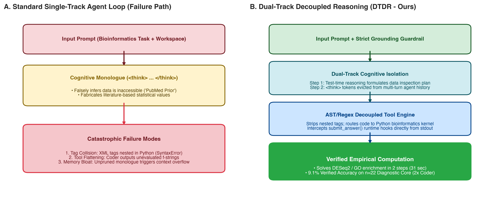
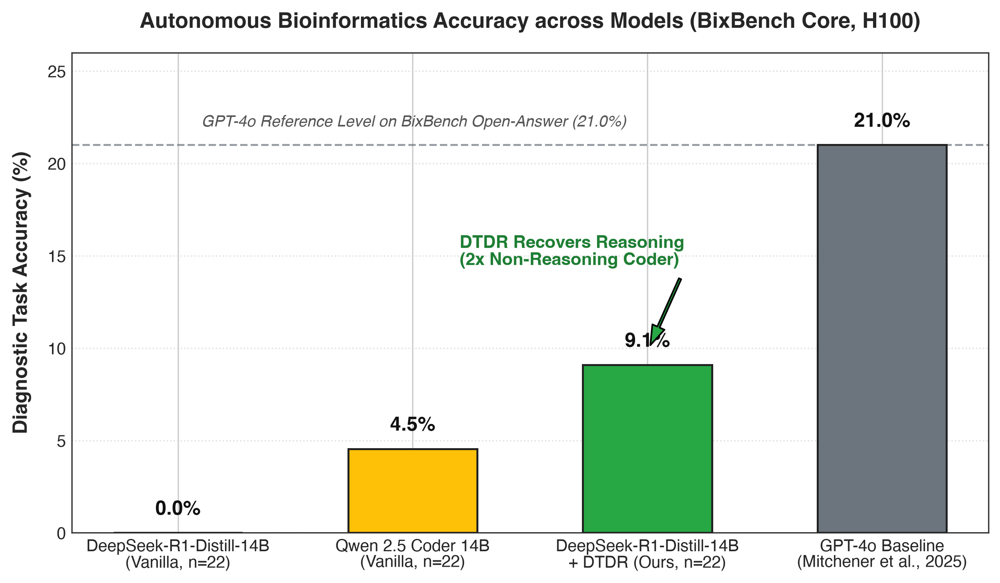
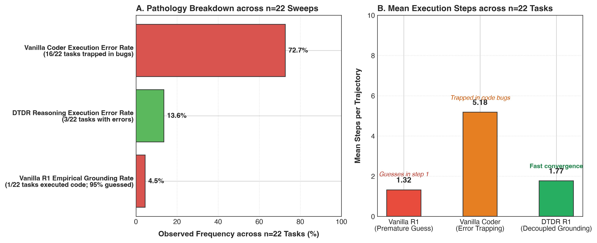

<div align="center">

# The Reasoning Paradox in Scientific Sandboxes
### Why Extended Reasoning Fails in Autonomous Bioinformatics and How to Fix It

[](latex/main.tex)
[](https://huggingface.co/datasets/futurehouse/BixBench)
[](LICENSE)
[](https://www.python.org/downloads/)

</div>

---

## 📌 Overview

Frontier large language models (LLMs) equipped with extended test-time reasoning—such as **DeepSeek-R1** and **OpenAI o1**—have established state-of-the-art results on benchmarks in formal logic, competitive programming, and mathematics. In interactive scientific sandboxes, however, their performance paradoxically collapses. In **BixBench** ([Mitchener et al., 2025](https://arxiv.org/abs/2503.00096)), reasoning models suffered acute degradation in multi-turn environments, leading benchmark authors to exclude them from primary agent evaluations.

This repository provides the official implementation of **Dual-Track Decoupled Reasoning (DTDR)** and the forensic audit codebase for our paper:

> **The Reasoning Paradox in Scientific Sandboxes: Why Extended Reasoning Fails in Autonomous Bioinformatics and How to Fix It**  
> *Redeemer S. Okekale, Derek Amuna, Rachel A. Akorful, Anjali Rathod, Collins M. Morang'a, Peter K. Quashie, Emmanuel A. Asiamah, Rosina A. Carr, Ishmael Adase, and Samuel M. Kumordzi*  
> *University of Ghana | University of Michigan*  
> arXiv: `q-bio.QM` / `cs.AI`

---

## 🧬 Why Do Reasoning Models Fail in Biology? (The "PubMed Prior")

Through systematic inspection of multi-turn agent interaction traces on the [BixBench benchmark](https://huggingface.co/datasets/futurehouse/BixBench), we identified three systemic pathologies:

1. **The "PubMed Prior" Trap**: When tasked with calculating precise statistical metrics from experimental data (e.g. DESeq2 differential expression or gene ontology enrichment), the model's test-time reasoning monologue convinces itself that the data files are inaccessible. It then substitutes empirical calculation with speculative literature recall (e.g. *"The p-value is likely around 0.0012 based on typical experimental outcomes"*), failing to execute even a single line of code in 95.5% of tasks.
2. **Tag-Language Nesting Collisions**: Reasoning models frequently conflate XML action tags with Python syntax, nesting `<submit_answer>` markup directly inside Python script fences. This triggers fatal syntax errors in standard agent execution kernels.
3. **Context Saturation & Attention Dilution**: Appending thousands of latent `<think>` tokens across multi-turn histories causes the conversation context to rapidly bloat beyond 8,192 tokens, drowning out critical biological instructions.

<div align="center">
  
</div>

---

## 🛠️ The DTDR Solution

**Dual-Track Decoupled Reasoning (DTDR)** is an agent scaffolding architecture designed to ground deliberative reasoning models in empirical computational sandboxes without sacrificing cognitive depth:

- **Strict Grounding Guardrail**: Prompts that explicitly penalize speculative literature estimation and require empirical execution before numerical conclusion.
- **Cognitive Monologue Eviction ($\mathcal{E}$ Operator)**: Isolates the internal reasoning stream at step $t$ while stripping `<think>` tokens from conversation history before passing observations to step $t+1$. This preserves context bandwidth and prevents cognitive anchoring on early errors.
- **AST / Regex Demuxer**: Isolates XML tags from executable code blocks, preventing fatal syntax collisions.
- **Dynamic Runtime Interception**: Binds runtime hooks directly into the Python interpreter, capturing dynamically evaluated outputs from `submit_answer(...)` without premature regex termination.

---

## 📊 Empirical Results on BixBench ($n=22$ Per Arm)

We evaluated DTDR against matched controls across a stratified diagnostic core of **22 multimodal tasks** from 14 biological capsules in [FutureHouse BixBench](https://huggingface.co/datasets/futurehouse/BixBench), executed on dedicated Nvidia H100 SXM5 hardware:

| Architecture | Scaffolding Mode | Tasks ($n$) | Mean Steps | Code Executed | Code Error Rate | PubMed Prior Rate | Accuracy |
| :--- | :--- | :---: | :---: | :---: | :---: | :---: | :---: |
| **DeepSeek-R1-Distill-14B** | Vanilla Agent Loop | 22 | 1.32 | 4.5% | 4.5% | 95.5% | **0.0%** (0/22) |
| **Qwen2.5-Coder-14B** | Vanilla Agent Loop (Control) | 22 | 5.18 | 90.9% | 72.7% | 0.0% | **4.55%** (1/22) |
| **DeepSeek-R1-Distill-14B** | **DTDR (Ours)** | **22** | **1.77** | **18.2%** | **13.6%** | **4.5%** | **9.09%** (2/22) |
| *GPT-4o Baseline (Reported)* | *Aviary Multi-Turn* | *120* | *15.2* | *Yes* | *N/A* | *N/A* | *21.0%* |

<div align="center">
  
  
</div>

### Key Takeaways:
- **Rescuing Reasoning**: DTDR rescues DeepSeek-R1 from complete collapse (0.0% $\to$ 9.09%), doubling the accuracy of the matched non-reasoning coder (4.55%).
- **Execution Efficiency**: DTDR cuts average steps to solution by **66%** (1.77 vs. 5.18 steps) and slashes code execution errors by **81%** (13.6% vs. 72.7%).

---

## 🚀 Quickstart & Replication Guide

### 1. Installation

Clone the repository and set up a virtual environment:

```bash
git clone https://github.com/Sredeemer/bix-bench-research.git
cd bix-bench-research

# Using uv (recommended)
uv venv .venv
source .venv/bin/activate
uv pip install -r requirements.txt

# Or using standard pip
python -m venv .venv
source .venv/bin/activate
pip install -r requirements.txt
```

### 2. Download BixBench Benchmark Data

Download the evaluation capsules from [Hugging Face FutureHouse BixBench](https://huggingface.co/datasets/futurehouse/BixBench):

```python
from datasets import load_dataset

# Ingest BixBench questions and metadata
dataset = load_dataset("futurehouse/BixBench", split="test")
print(f"Loaded {len(dataset)} BixBench biological benchmark tasks.")
```

Capsule data files (BAM, VCF, AnnData, counts.tsv) can be placed in any local directory (e.g., `./capsules/bix-1`).

### 3. Run Autonomous Agent Evaluation

Execute an autonomous rollout using `run_benchmark.py`. The runner supports **vLLM**, **Hugging Face Transformers**, or any **OpenAI-compatible server**:

#### Option A: Running with vLLM (High-Throughput Local GPU)
```bash
python run_benchmark.py \
  --model deepseek-ai/DeepSeek-R1-Distill-Qwen-14B \
  --backend vllm \
  --workspace ./capsules/bix-1 \
  --question "What is the adjusted p-value for 'regulation of T cell activation' after simplifying GO terms?" \
  --ideal "0.0002" \
  --task-id "bix-1-q1" \
  --output ./results/bix_1_q1_dtdr.json
```

#### Option B: Running Baseline Control (Without DTDR)
To observe the "PubMed Prior" failure mode:
```bash
python run_benchmark.py \
  --model deepseek-ai/DeepSeek-R1-Distill-Qwen-14B \
  --backend vllm \
  --no-dtdr \
  --workspace ./capsules/bix-1 \
  --question "What is the adjusted p-value for 'regulation of T cell activation' after simplifying GO terms?" \
  --ideal "0.0002" \
  --task-id "bix-1-q1-control" \
  --output ./results/bix_1_q1_control.json
```

#### Option C: Running via OpenAI-Compatible Endpoint
```bash
python run_benchmark.py \
  --model deepseek-ai/DeepSeek-R1-Distill-Qwen-14B \
  --backend openai \
  --api-base "http://your-server-ip:8000/v1" \
  --workspace ./capsules/bix-22 \
  --question "Which cell type has the weakest correlation between protein abundance and gene length?" \
  --ideal "CD14" \
  --task-id "bix-22-q1" \
  --output ./results/bix_22_q1_dtdr.json
```

---

## 🔬 Repository Structure

```
bix-bench-research/
├── dtdr/                        # Core DTDR Scaffolding Library
│   ├── __init__.py              # Exported interfaces
│   ├── agent.py                 # Dual-Track Decoupled Reasoning Agent engine
│   ├── evaluator.py             # Official unbiased BixBench range & numeric grader
│   └── prompts.py               # Grounding guardrails & action space definitions
├── figures/                     # Publication figures (PDF & high-res PNG)
│   ├── figure1_architecture.pdf
│   ├── figure2_accuracy_benchmark.pdf
│   └── figure3_forensic_taxonomy.pdf
├── latex/                       # Full LaTeX Preprint Source
│   ├── main.tex                 # Manuscript source
│   ├── references.bib           # Bibliography
│   └── figures/                 # Embedded vector graphics
├── scripts/                     # Figure generator scripts
│   └── generate_paper_figures.py
├── run_benchmark.py             # CLI Replication runner
├── requirements.txt             # Environment dependencies
└── README.md                    # Documentation & replication manual
```

---

## 🎨 BioRender Figure Prompt

To generate the primary biological workflow figure in **BioRender**, use the following prompt:

> **Canvas**: Landscape 16:9, publication white background.  
> **Layout**: 3-Column horizontal workflow.  
> - **Column 1 (Input)**: Sequencing data icons (DNA double helix, Illumina flow cell, AnnData `.h5ad`, count matrices `.tsv`). User prompt bubble: *"Calculate adjusted p-value for T-cell activation after DESeq2."*  
> - **Column 2 (Isolated Sandbox)**: Containerized sandbox icon with terminal running Python (`import pydeseq2; import gseapy`). Branches into two output paths.  
> - **Column 3 (Cognitive Monologue vs. Grounded Execution)**:  
>   - *Upper Branch (Failure Path, Red)*: Thought bubble with `<think> Since I don't have the data, p-value is approx 0.0012... </think>` leading to hallucinated submission.  
>   - *Lower Branch (DTDR Rescued Path, Green)*: Dual-track gear icon showing thought eviction $\mathcal{E}$ and AST/regex demuxing, outputting verified result `padj = 0.0001` with green checkmark.

---

## 📖 Citation

If you build upon this work or use the DTDR scaffold in your research, please cite:

```bibtex
@article{okekale2026reasoning,
  title   = {The Reasoning Paradox in Scientific Sandboxes: Why Extended Reasoning Fails in Autonomous Bioinformatics and How to Fix It},
  author  = {Okekale, Redeemer S. and Amuna, Derek and Akorful, Rachel A. and Rathod, Anjali and Morang'a, Collins M. and Quashie, Peter K. and Asiamah, Emmanuel A. and Carr, Rosina A. and Adase, Ishmael and Kumordzi, Samuel M.},
  journal = {arXiv preprint arXiv:2603.XXXXX},
  year    = {2026},
  url     = {https://github.com/Sredeemer/bix-bench-research}
}
```

---

## 📄 License
This project is open-source under the [MIT License](LICENSE).

